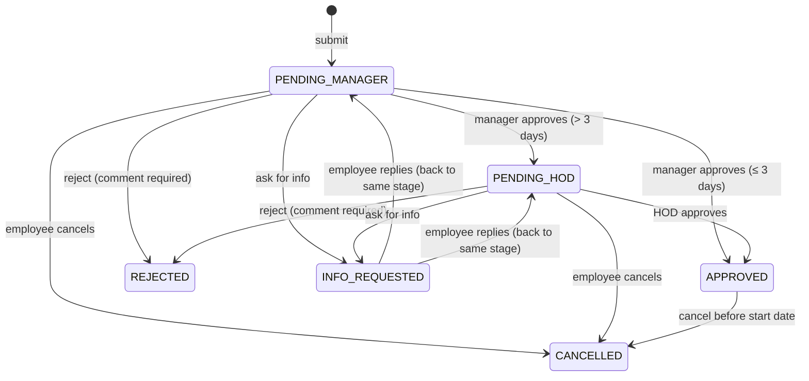

# LeaveDesk: Employee Leave Management System

A web portal where employees apply for leave and managers / HODs approve or reject it. Long leave (more than 3 working days) requires supporting documents and a two-level approval: **Manager, then HOD**.

**Stack:** React 19 (Vite) · Node.js + Express 5 · SQLite (Node's built-in `node:sqlite`) · JWT auth · zod validation

---

## 1. Run it (pick one)

### Option A: Docker (nothing else to install)

```bash
docker compose up --build
```

Open **http://localhost:3000**.

### Option B: Node.js 22.13+ (one command)

| OS | Command |
|----|---------|
| Linux / macOS | `./start.sh` |
| Windows | double-click `start.bat` |
| Any | `npm install && npm start` |

Open **http://localhost:3000**. On the first run the script installs dependencies, builds the UI, creates the database and loads demo data. Nothing else is needed: no database server, no `.env` file.

> Check your Node version with `node -v`. On older Node, use Docker (Option A) or install the current LTS from https://nodejs.org.

### Useful commands

| Command | What it does |
|---------|--------------|
| `npm start` | Build the UI and start the server (single port: 3000) |
| `npm run serve` | Start without rebuilding the UI |
| `npm run dev` | Development mode with hot reload (UI on :5173, API on :3000) |
| `npm test` | Run the automated API/workflow tests |
| `npm run reset` | Wipe the database and re-create the demo data |
| `PORT=4000 npm start` | Use a different port |

---

## 2. Demo accounts

All passwords: **`Password@123`**. The login page also has one-click demo buttons.

| Role | Name | Email | Notes |
|------|------|-------|-------|
| Employee | John Doe | `employee@example.com` | Has pending, approved and rejected requests |
| Employee | Ananya Iyer | `ananya@example.com` | Has a request where the manager asked for more info |
| Manager | Rahul Verma | `manager@example.com` | Approves Engineering employees (level 1) |
| HOD | Meera Nair | `hod@example.com` | Level-2 approver for Engineering + **Audit log** |
| Manager | Sneha Kapoor | `ops.manager@example.com` | Operations department (data isolation demo) |
| Employee | Karan Mehta | `ops.employee@example.com` | Operations department |
| HOD | Vikram Rao | `ops.hod@example.com` | Operations HOD |

### Suggested 3-minute walkthrough

1. **Employee (John):** *Apply leave* for Mon–Fri next week. The form counts **5 working days**, flags it as long leave, requires a document and shows the route *Rahul → Meera*. Try submitting without a file to see the validation, then attach any PDF/JPG and submit.
2. **Manager (Rahul):** the *Approvals* badge shows the new request. Open it, view the document, try **Reject** without a comment (blocked), then **Approve** with a comment. The request moves to *Pending · HOD*.
3. **HOD (Meera):** approve it. The stepper shows both levels done. Open **Audit log** to see every sign-in, decision and document view.
4. **Employee (Ananya):** open the request marked *Info requested*, reply and attach a file. It goes back to the manager.
5. Sign in as **Sneha (Operations manager)** and try opening an Engineering request URL such as `/leaves/1`. You get "not found", because data is isolated per team.

---

## 3. Features (mapped to the assignment)

| Requirement | Where |
|-------------|-------|
| Employee: apply for leave | *Apply leave* page. Live working-day count, approval route preview, inline validation |
| Employee: view submitted requests / history | *My leaves* (filter by status) and *Dashboard* |
| Employee: check status | Color-coded status badges, approval stepper, full history timeline per request |
| Employee: attach documents | Drag-and-drop upload when applying, replying or later (PDF, JPG, PNG, DOC, DOCX, ≤ 5 MB, ≤ 5 files) |
| Manager: view all pending requests | *Approvals → Waiting for me* (with count badge in the nav) and *All team requests* |
| Manager: approve / reject with comments | Decision panel on the request page. A comment is **required** to reject |
| Manager: view documents | Inline *View* (opens in new tab) and *Download* |
| Manager: ask for more information | *Ask for more info*. Status becomes **Info requested**; the employee replies (optionally with files) and the request returns to the same approver |
| **> 3 consecutive working days** | Document is mandatory, and approval goes **Manager → HOD**. Enforced on the server, mirrored in the UI |
| Audit logs *(plus)* | Append-only `audit_logs` table (database triggers block UPDATE/DELETE); HOD *Audit log* page with filters |
| Friendly error messages *(plus)* | Every API error has the form `{ error: { code, message, fields } }` and is shown inline and as a toast |
| Color coding *(plus)* | Amber = pending, blue = info requested, green = approved, red = rejected, grey = cancelled; leave types have their own colors |
| Responsive *(plus)* | Works from 360 px phones to desktop; tables become cards on mobile; light and dark themes |
| CRUD | **C**reate request · **R**ead list/detail · **U**pdate (edit while pending; restarts approval) · **D**elete as a soft delete (*Cancel*, kept for audit) |

---

## 4. Business rules

All rules live in [`server/src/services/policy.js`](server/src/services/policy.js) and are served to the UI from `GET /api/policy`, so they are defined in one place.

* **Working days:** Monday to Friday, inclusive of both dates; weekends are not counted. (Public holidays are a listed future improvement.)
  * The sample payload `2026-11-01 → 2026-11-05` is Sun–Thu = **4 working days**, so it is long leave.
* **Long leave (> 3 working days):** at least one supporting document is required, and the request needs two approvals: *reporting manager* (level 1), then *department HOD* (level 2).
  * If the applicant's reporting manager **is** the HOD (e.g. a manager applying), a single HOD approval covers both levels, so the same person is not asked twice.
* **Approver chain is snapshotted** at submission, so later org changes don't silently re-route requests already in flight.
* Only the **current** approver can act. The HOD cannot skip the manager, and nobody can approve their own leave.
* **Reject** and **Ask for info** require a comment; *Approve* comments are optional.
* **Editing** a pending request **restarts approval from level 1**, so every approver signs off on the final dates.
* **Cancel:** allowed while pending, or for approved leave that hasn't started yet.
* **Validation:** valid calendar dates; end ≥ start; no overlap with your other pending/approved leave; backdating ≤ 30 days (e.g. sick leave); planning ≤ 1 year ahead; ≤ 60 days per request; reason 5–500 chars; weekend-only ranges rejected.
* The `employeeName` field from the sample JSON is accepted but **ignored**: the employee is always the signed-in user, so nobody can file leave for someone else.

### Workflow (state machine)



In the database this is `status` (`PENDING`, `INFO_REQUESTED`, `APPROVED`, `REJECTED`, `CANCELLED`) plus `current_stage` (`MANAGER` / `HOD`).

---

## 5. Architecture

```
leave-management-system/
├── server/src/
│   ├── index.js / main.js     entry point (Node version check, seed, listen)
│   ├── app.js                 Express app + dependency wiring
│   ├── config.js              env-based configuration
│   ├── db/                    schema.sql, connection + transactions, demo seed, reset
│   ├── repositories/          SQL only (User, Leave, Action, Document, Audit)
│   ├── services/              business logic: LeaveService (workflow), AuthService, policy
│   ├── middleware/            auth (JWT + RBAC), uploads (multer), error handler
│   └── routes/                thin HTTP layer → services
├── server/tests/              node:test + supertest (workflow, RBAC, validation, audit)
└── client/src/
    ├── pages/                 Login, Dashboard, Apply/Edit, My leaves, Detail, Approvals, Audit log
    ├── components/            LeaveForm, LeaveTable, FileInput, stepper/timeline, UI kit
    ├── context.jsx            auth, toasts, policy, data-fetching hook
    └── api.js                 fetch wrapper with friendly errors
```

**Layers:** Routes (HTTP) → Services (rules / state machine) → Repositories (SQL) → SQLite. Services receive their repositories through the constructor (dependency injection), so tests can run on an in-memory database with a fixed clock.

**Reliability:**
* Each state change, its timeline entry and its audit row are written in **one transaction**.
* State changes use **compare-and-set** (`UPDATE … WHERE status = ? AND current_stage = ?`). If two approvers click at the same time, one wins and the other gets a friendly *"updated by someone else"* (HTTP 409) instead of a corrupted state.

### Data model

| Table | Purpose |
|-------|---------|
| `departments` | Engineering, Operations… |
| `users` | name, email (unique), bcrypt hash, role (`EMPLOYEE`/`MANAGER`/`HOD`), department, reporting manager |
| `leave_requests` | type, dates, working days, reason, status, current stage, approver snapshot, timestamps |
| `leave_actions` | per-request timeline: who did what, at which stage, with which comment |
| `documents` | file metadata; the file is stored on disk under a random name |
| `audit_logs` | system-wide append-only trail (actor, action, entity, JSON details, IP, time) |

The SQL uses standard types and app-generated timestamps, so moving to PostgreSQL/MySQL mostly means swapping the connection in `db/database.js`.

### REST API

All endpoints are under `/api` and return JSON. Errors are always `{ "error": { "code", "message", "fields"? } }`.

| Method | Path | Who | Description |
|--------|------|-----|-------------|
| POST | `/auth/login` | public | Sign in (sets httpOnly cookie). Rate-limited |
| POST | `/auth/logout` | any | Sign out |
| GET | `/auth/me` | any | Current user or `null` |
| GET | `/policy` | public | Business rules for the UI |
| GET | `/dashboard` | signed in | Role-aware summary |
| GET | `/leaves?status=` | signed in | My requests |
| POST | `/leaves` | Employee/Manager | Create (JSON or multipart with `documents[]`) |
| GET | `/leaves/:id` | involved users | Detail + documents + timeline + allowed actions |
| PATCH | `/leaves/:id` | owner | Edit while pending (restarts approval) |
| POST | `/leaves/:id/cancel` | owner | Cancel |
| POST | `/leaves/:id/respond` | owner | Reply to an info request (+ files) |
| POST | `/leaves/:id/documents` | owner | Add documents |
| GET | `/approvals/pending` | Manager/HOD | Requests waiting for me |
| GET | `/approvals/team?status=` | Manager/HOD | All requests I can see |
| POST | `/leaves/:id/approve` | current approver | Approve (optional `comment`) |
| POST | `/leaves/:id/reject` | current approver | Reject (`comment` required) |
| POST | `/leaves/:id/request-info` | current approver | Ask for more info (`comment` required) |
| GET | `/documents/:id[?download=1]` | involved users | View / download a file |
| GET | `/audit-logs?action=&offset=` | HOD | Department audit trail |

Example, using the payload from the assignment:

```bash
curl -c jar -X POST localhost:3000/api/auth/login -H 'Content-Type: application/json' \
     -d '{"email":"employee@example.com","password":"Password@123"}'

curl -b jar -X POST localhost:3000/api/leaves -H 'Content-Type: application/json' \
     -d '{"employeeName":"John","fromDate":"2026-11-01","toDate":"2026-11-05","reason":"Vacation"}'
# -> 400: "This leave is 4 working days. Leave of more than 3 working days needs a supporting document…"

curl -b jar -X POST localhost:3000/api/leaves -F fromDate=2026-11-16 -F toDate=2026-11-20 \
     -F reason="Vacation" -F documents=@ticket.pdf
# -> 201, status PENDING at MANAGER stage, HOD approval queued
```

---

## 6. Security

* Passwords hashed with **bcrypt**; the login response takes the same time whether or not the email exists (no user enumeration).
* Session = **JWT in an httpOnly, SameSite=Lax cookie**: not readable by JavaScript (XSS), not sent on cross-site POSTs (CSRF). Login is rate-limited.
* **RBAC** on every route and **object-level checks** in the service: users who aren't involved get *404* (not 403), so request IDs can't be probed.
* All input is validated server-side with **zod**, and all SQL is parameterised.
* Uploads: MIME type **and** extension allow-list, size/count limits, stored under random names outside the web root, served only after a permission check (`Cache-Control: no-store`). Rejected uploads are deleted.
* `helmet` security headers (CSP, nosniff, frame protection). Errors never leak stack traces.
* The JWT secret is taken from `JWT_SECRET`, or generated randomly on first run and stored in `data/` (never committed).

## 7. Tests

```bash
npm test
```

18 tests (Node's built-in test runner + supertest, in-memory DB, fixed clock) cover: working-day counting, date rules, the short and long approval flows, the document requirement, HOD-can't-skip-manager, cross-department isolation, reject-needs-comment, the info-request round trip, edit-restarts-chain, cancel permissions, RBAC, upload type checks, and audit-log immutability.

## 8. Configuration

| Variable | Default | Meaning |
|----------|---------|---------|
| `PORT` | `3000` | HTTP port |
| `DATA_DIR` | `./data` | Database, uploads and generated secret |
| `JWT_SECRET` | auto-generated | Session signing key |
| `SESSION_HOURS` | `8` | Session length |
| `COOKIE_SECURE` | `false` | Set `true` when served over HTTPS |
| `SEED_DEMO_DATA` | `true` | Load demo users/requests into an empty database |

## 9. Trade-offs and next steps

* **SQLite** was chosen so assessors can run the app with zero setup. In production I'd use PostgreSQL (the repository layer isolates the SQL) and object storage (S3) for documents.
* **Next:** email/Slack notifications, public-holiday calendar per location, leave balances and accrual, delegation when an approver is on leave, SSO, and a reporting dashboard.

## 10. AI-assisted development

This project was built with AI coding assistants as pair programmers (design discussion, code generation, test writing and UI review through browser automation). Every design decision was reviewed and made by me, including the stack, the SQLite-vs-Supabase choice, and counting working days instead of calendar days. Every feature was verified with automated tests and by clicking through the UI.
